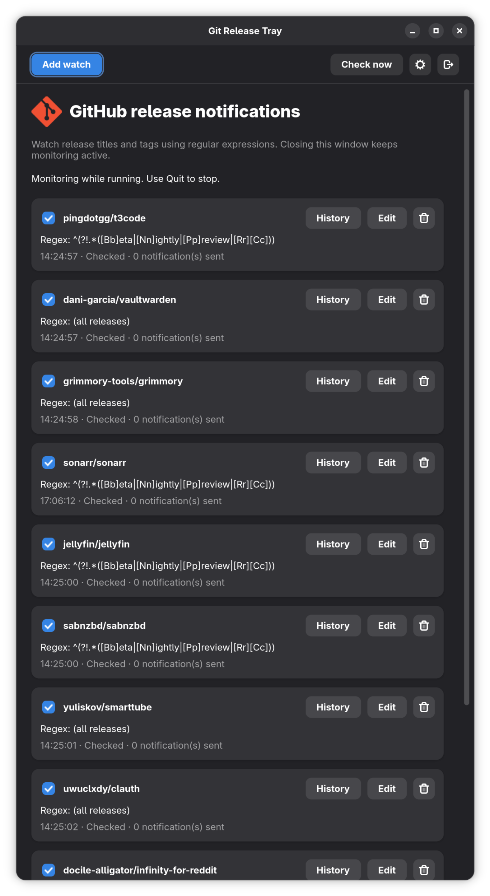
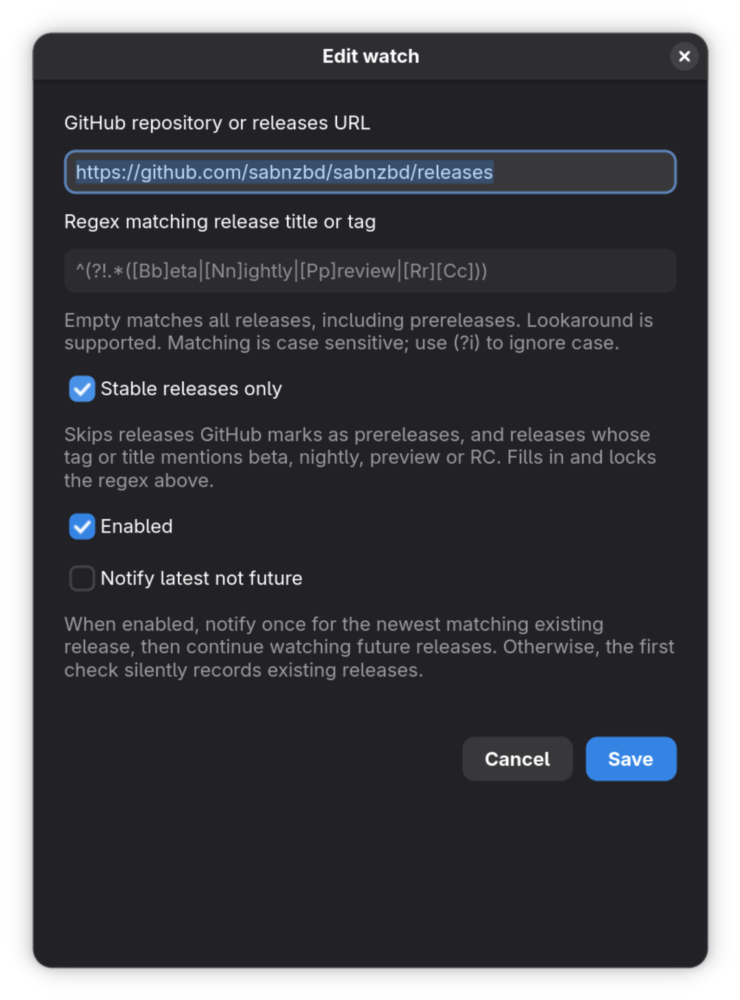
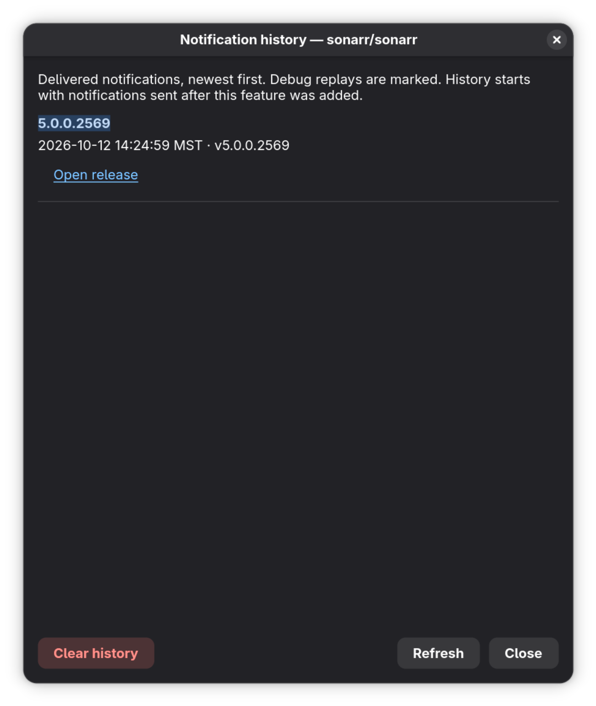

# Git Release Tray

A Rust GTK4/libadwaita application that watches public GitHub repositories and
sends GNOME desktop notifications when release titles or tags match a regex.
Includes a settings window, StatusNotifier/AppIndicator tray menu, persistent
notification history, and repeatable debug notifications.

## Screenshots




## Build and run

Install a current stable Rust toolchain and the native development packages:

```sh
# Fedora
sudo dnf install gcc pkg-config gtk4-devel libadwaita-devel

# Debian / Ubuntu
sudo apt install build-essential pkg-config libgtk-4-dev libadwaita-1-dev

cargo run --locked
```

Run inside your graphical desktop session with access to its session D-Bus.
GNOME needs the **AppIndicator and KStatusNotifierItem Support** extension to
display the tray icon. The settings window works without it. The tray offers
Open, Check now, and Quit. Closing the window keeps monitoring active; use Quit
to stop. Launching the app again reopens the existing instance.

Install the release binary, desktop launcher, and icon for your user:

```sh
make install
```

The default installation prefix is `~/.local`; override with `make install
PREFIX=/absolute/path`. The generated launcher uses the installed binary's
absolute path. Launch **Git Release Tray** from the application menu. Launch at
login is not enabled automatically.

## Watches

Choose **Add watch**, paste an HTTPS GitHub URL, and enter a regex. Accepted URLs:

```text
https://github.com/owner/repository
https://github.com/owner/repository/releases
https://github.com/owner/repository/releases/latest
https://github.com/owner/repository/releases/tag/v1.2.3
```

All forms watch the repository's releases, including prereleases, rather than
pinning a particular tag. Drafts are ignored. The regex matches either the
release title or tag, not the notes. An empty regex matches all releases.
Matching is case sensitive unless you use `(?i)`.

| Regex | Meaning |
| --- | --- |
| `^v[0-9]+\.[0-9]+\.[0-9]+$` | Plain three-part version tags |
| `(?i)beta\|rc` | Beta or release-candidate titles/tags |
| `^v2\.` | Version 2 tags |

The regex engine is `fancy-regex`, with lookahead, lookbehind, and backreferences.
For example, `(?i)^(?!.*rc).*$` excludes text containing RC regardless of case.
A match in either title or tag still qualifies the release. Validation errors
appear before saving; patterns exceeding the engine's backtracking limit report
an error without consuming releases.

By default the first successful check records existing releases silently, then
notifies for matching releases first discovered on subsequent checks. Releases
published while the app was stopped or a watch was paused are discovered on its
next check, provided they are still among the repository's newest 100 releases.
Notification history survives restarts. Changing a regex does not
replay releases already discovered. Changing the repository creates a fresh
baseline.

**Notify latest not future** is a per-watch setting, disabled by default. When
enabled, it requests one notification for the newest matching existing release,
**then continues watching future releases**. Enabling it later requests another
latest notification. With no existing match, it simply continues monitoring.
“Newest” is determined by publication time, not semantic-version sorting.

Checks run on startup and every five hours by
default. Open the Settings gear to set a 1–24 hour interval; changes take effect
and save automatically, rescheduling the next periodic check. Adding, editing,
or enabling a monitor checks only that monitor; other monitors keep their status
and schedule. Check now
runs an immediate check. Each watch shows its status and last-check time.
Existing settings saved in minutes are converted to hours, rounded up to the
next whole hour (for example, 5 minutes becomes 1 hour).

## Repeatable notification testing

Open the **Settings** gear button and enable **Debug mode**, or start with:

```sh
cargo run --locked -- --debug
```

Each manual **Check now** sends the newest matching release for every enabled
watch, even if that release was already notified or recorded in the initial
baseline. Repeat Check now to test again. Notifications are marked `[Debug]`.
Debug replays are recorded in the activity log but do not change normal release deduplication. Automatic checks continue
normal deduplication. Debug mode is session-only. GNOME's notification/Do Not
Disturb settings may suppress the visible banner even when delivery succeeds.

Click a notification's Open release action to visit its GitHub page.

## Storage and networking

- Settings: `$XDG_CONFIG_HOME/gnome-git-release-tray/config.json` (normally
  `~/.config/gnome-git-release-tray/config.json`).
- History: `$XDG_STATE_HOME/gnome-git-release-tray/history.json` (normally
  `~/.local/state/gnome-git-release-tray/history.json`).
- Writes use temporary files, file synchronization, and atomic rename. Invalid
  stored data is reported without overwriting it; close the app before editing
  these files manually.
- GitHub requests use timeouts. A watch's first check, a latest request, and
  Debug mode page through the newest 1,000 releases, the most GitHub lists;
  later checks fetch only the newest 100. Requests are shared between
  watches of the same repository within a check. Rate-limit responses delay
  subsequent requests, including manual checks.
- Optionally set `GITHUB_TOKEN` in the application's environment for a higher
  API quota. The token is never saved in the settings file. Private-repository
  support and login UI are outside this version's scope.
- Pending notifications survive delivery failures and are retried on the next
  successful check. A crash between desktop delivery and saving its receipt
  can cause a duplicate; delivery is not an exactly-once transaction with D-Bus.
- Editing settings may interrupt the current HTTP request; unfinished monitors
  resume afterward without rechecking monitors that already completed.
  Removing a watch stops its monitoring; adding it again starts a fresh watch.

## Development and verification

```sh
cargo fmt --check
cargo clippy --all-targets -- -D warnings
cargo test --locked
# Core tests without GTK development packages or a graphical session:
cargo test --locked --no-default-features
```

The core uses mock HTTP responses and notification sinks to test pagination,
rate-limit backoff, parsing, matching, baselines, persistent deduplication,
latest notifications, and delivery retries.

For a desktop smoke test, add a public repository with an empty filter. Confirm
the first check is silent; open Settings, enable Debug mode, and click Check now twice to see
repeat notifications. Test the Open release action, disable debug, edit and
pause watches, close/reopen the window from the tray and application launcher,
and quit. Verify window access with the AppIndicator extension disabled too.

The bundled application, tray, and notification logo uses the [provided GitHub avatar](https://avatars.githubusercontent.com/u/18133?s=200&v=4). It is embedded for local runs and installed with the desktop launcher.

## Notification history

Each monitor has a **History** button showing delivered notifications, newest
first, with local delivery time, release title, tag, and an Open release link.
Debug replays are marked and included without affecting normal deduplication.
The log survives restarts; Refresh updates an open history window. Failed
submissions and silently baselined releases are excluded. Older versions did not
retain delivery details, so historical notifications cannot be reconstructed.

Windows initially use half the display height and remain resizable. Vertical
scrollbars appear automatically when the monitor list or dialog content overflows.
